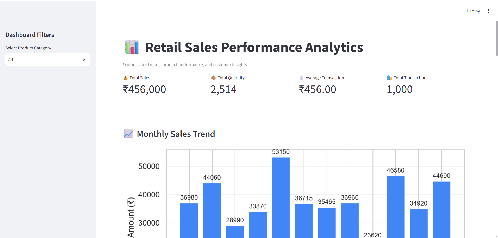
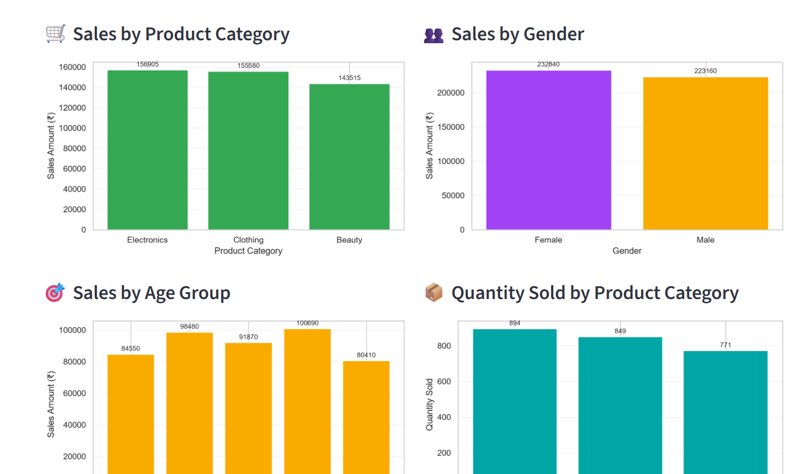
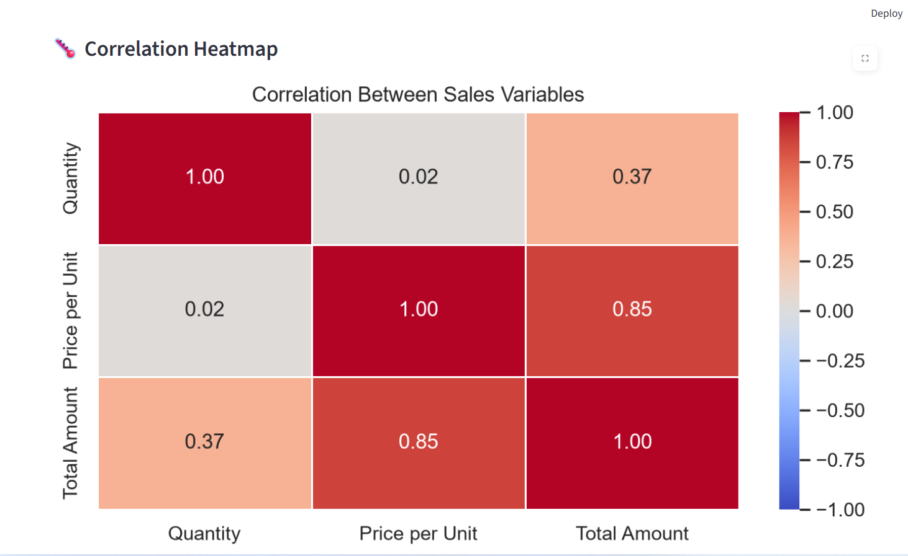

# Retail Sales Performance Analytics

## Project Overview
This project analyzes retail sales data using Python and presents the results through an interactive Streamlit dashboard. It helps users explore sales trends, product performance, customer segments, and relationships between sales variables.

## Objectives
- Analyze total sales and quantities sold.
- Compare sales across product categories and genders.
- Understand sales distribution across age groups.
- Explore monthly sales trends.
- Visualize correlations between quantity, unit price, and total amount.
- Build an interactive dashboard with a product category filter.

## Tools and Technologies
- Python
- Pandas
- Streamlit
- Matplotlib
- Seaborn
- Jupyter Notebook

## Dashboard Features
- Interactive product category filter
- KPI cards for total sales, quantity, average transaction, and transaction count
- Monthly sales trend chart
- Sales by product category and gender
- Sales by age group
- Quantity sold by category
- Price per unit versus total amount scatter plot
- Correlation heatmap

## Key Findings
- Total sales across the dataset: ₹456,000.
- Electronics generated the highest total sales at ₹156,905.
- Female customers contributed ₹232,840 in sales.
- Clothing had the highest quantity sold, with 894 units.
- May recorded the highest monthly sales at ₹53,150.
- Price per unit had a strong positive correlation with total amount (approximately 0.85).

## How to Run the Project

1. Clone or download this repository.
2. Open the project folder in VS Code.
3. Create and activate a Python virtual environment if needed.
4. Install the dependencies:

   ```bash
   pip install -r requirements.txt
   ```

5. Run the dashboard:

   ```bash
   streamlit run retail_dashboard.py
   ```

6. Open the local URL displayed in the terminal.

## Project Files
- `retail_dashboard.py` — Streamlit dashboard
- `retail_sales_dataset.csv` — Dataset
- `retail_sales.ipynb` — Data analysis and exploration
- `requirements.txt` — Required Python libraries

## Dashboard Preview

### Sales Overview


### Sales Analysis


### Correlation Heatmap

